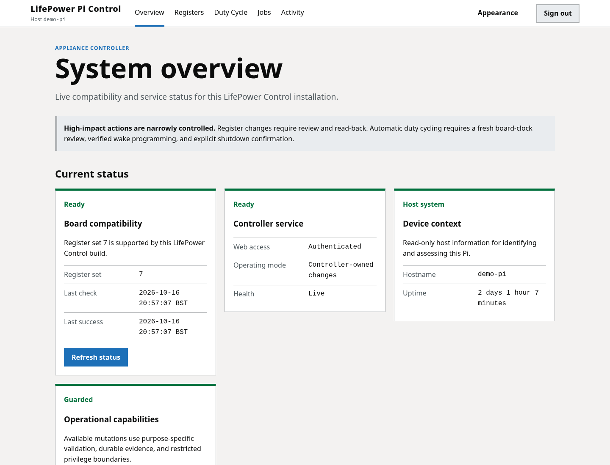
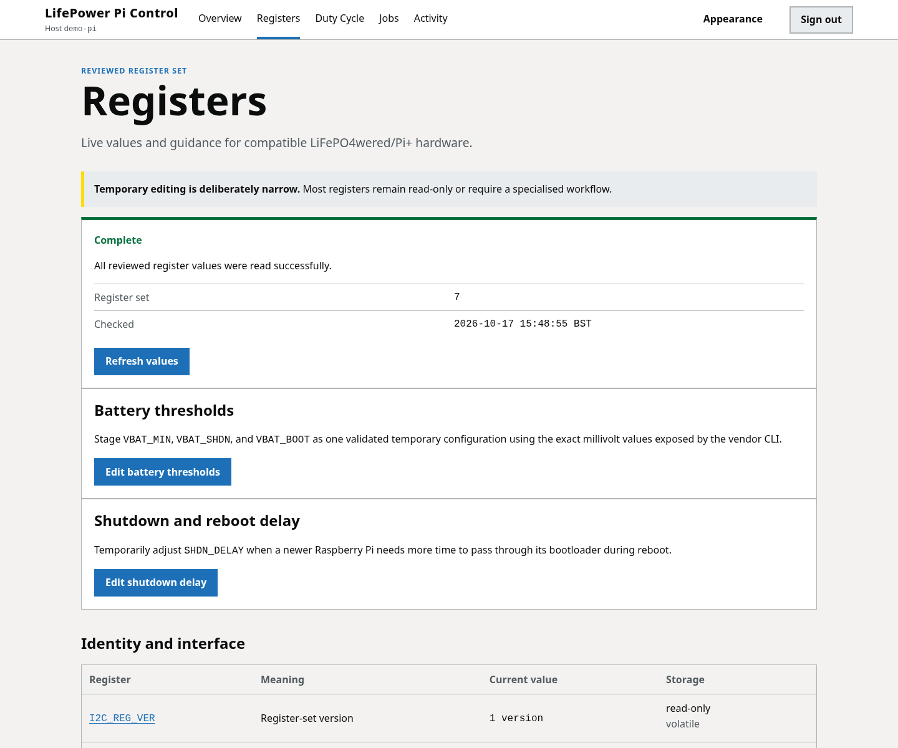
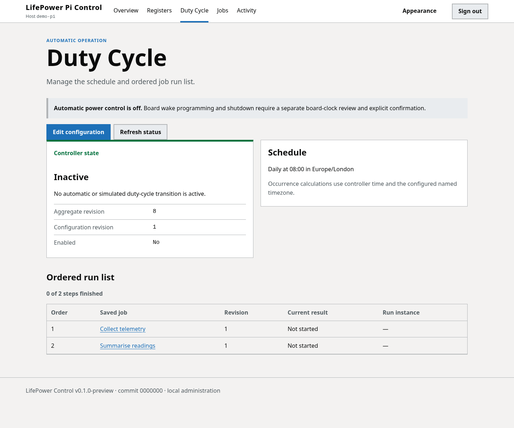

# LifePower Control

LifePower Control is a small, local web application for owners of a
LiFePO4wered/Pi+ board attached to a Raspberry Pi. It shows board status and
telemetry, provides guarded temporary configuration changes, runs saved owner
jobs, and can coordinate scheduled work with verified wake and orderly
shutdown.

The application is deliberately local-first. Its web interface listens only
on `127.0.0.1:8080` by default and is intended to be used on the Pi itself or
through an SSH tunnel. It is not a hosted service and should not be exposed
directly to the Internet.

## Release status

`v0.1.0` is the first supported release. Install only a version shown as
published on this repository's GitHub Releases page. Draft releases,
development builds, and locally rendered assets are not supported production
downloads.

The first release targets:

- LiFePO4wered/Pi+ hardware supported by the manufacturer's software;
- Raspberry Pi OS Lite 64-bit Trixie as the primary platform;
- Raspberry Pi OS Lite 64-bit Bookworm as a legacy compatibility platform;
- ARM64 Raspberry Pi systems; and
- the manufacturer's `lifepo4wered-cli` and daemon installed at their standard
  paths.

ARMv7/32-bit Raspberry Pi OS, generic Debian ARM64 systems, other UPS boards,
containers, and direct Internet exposure are not supported by the first
release.

## Interface preview

The images below are rendered from the real application templates with
deterministic demo services. The host, timestamps, build identity, and register
values are examples; they are not captured from an owner's Pi.







## What it provides

- A dashboard with board identity, power state, battery information, and
  diagnostics.
- A reviewed register catalogue and purpose-specific editors for safe,
  temporary changes.
- Password authentication, CSRF protection, bounded sessions, and local
  recovery.
- Saved direct-exec or explicit shell jobs, sequential execution, bounded
  output, and an Activity history.
- Duty-cycle scheduling with conservative boot classification, verified wake
  programming, and an orderly-poweroff boundary.
- Separate locked controller/web and selected-owner job identities under
  systemd.
- Transactional install, upgrade, rollback, recovery, and data-preserving
  uninstall behavior.

## Important safety limits

Temporary register changes do **not** invoke `CFG_WRITE` and are not persisted
to the board's flash. Flash persistence is intentionally excluded from the
first release. LifePower Control also fails safe: uncertain board, wake, job,
or persisted state disables automation and leaves the Pi powered on for owner
review.

Saved jobs run with the existing permissions of the ordinary Linux account
selected during installation. They are not a hostile-code sandbox. Only save
commands you trust, and remember that their output can contain secrets.

Read [Safety](docs/safety.md) before changing registers or enabling a duty
cycle.

## Getting started

For a published release, follow the exact-version download and verification
procedure in [Installation](docs/installation.md). The installer checks the OS
architecture, manufacturer prerequisite, accounts, paths, and service policy
before making changes. It uses loopback port `8080` by default; pass
`--port PORT` during a fresh install to select another unprivileged port.

After installation, open an SSH tunnel from your normal computer, using the
port printed by the installer on both sides. For the default:

```console
ssh -N -L 8080:127.0.0.1:8080 pi@raspberrypi.local
```

Then visit <http://127.0.0.1:8080/> and use the one-time setup link printed by
the installer to create the owner password. Replace the example SSH account
and hostname with those configured on your Pi.

## Documentation

- [Installation](docs/installation.md)
- [User guide](docs/user-guide.md)
- [Configuration](docs/configuration.md)
- [Operations and service management](docs/operations.md)
- [Troubleshooting](docs/troubleshooting.md)
- [Recovery](docs/recovery.md)
- [Upgrade and uninstall](docs/upgrade-and-uninstall.md)
- [Safety](docs/safety.md)
- [Documentation index](docs/README.md)

Developers should begin with [Contributing](CONTRIBUTING.md),
[Development](docs/development.md), [Architecture](docs/architecture.md), and
[Project state](docs/project-state.md).

## Licence and support

LifePower Control is available under the [MIT License](LICENSE). Third-party
dependencies retain their own licences; see [Third-party notices](THIRD_PARTY_NOTICES.md).
For supported-version and help expectations, see [Support](SUPPORT.md). Report
security issues using the private process in [Security](SECURITY.md).
